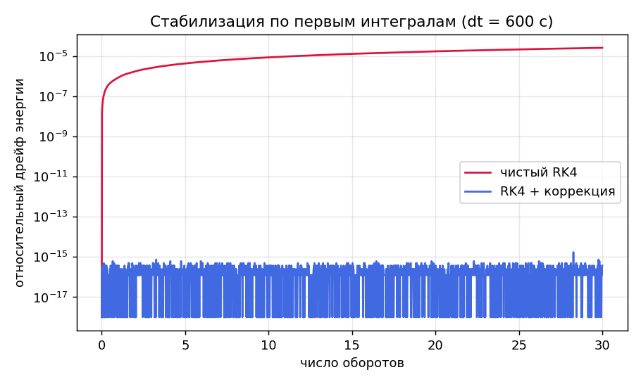
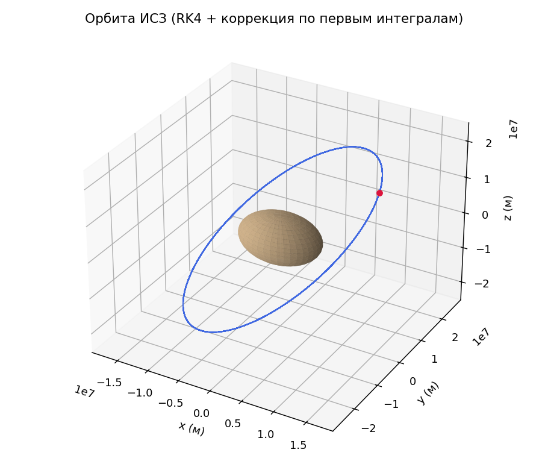
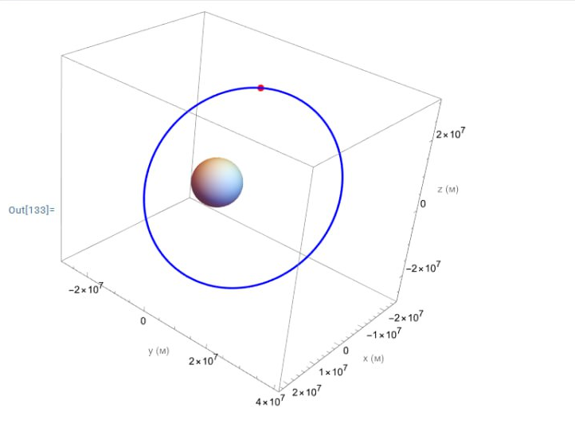

# Стабилизированное интегрирование орбиты ИСЗ по первым интегралам

Численное прогнозирование **невозмущённого движения ИСЗ** методом Рунге–Кутты 4-го порядка с
**коррекцией по первым интегралам** задачи Кеплера: чтобы решение как можно дольше не расходилось,
состояние периодически «подтягивается» обратно на многообразие сохраняющихся величин методом Ньютона.
Реализовано на **Wolfram Language** и продублировано на **Python**.

> **Short summary (EN).** RK4 propagation of an Earth satellite's two-body orbit with a
> *first-integral projection* stabilizer. The Kepler problem conserves six integrals — the angular
> momentum vector **c** = r×v and the Laplace–Runge–Lenz vector **f** = v×c − μ r/|r|. After each RK4
> step, if the integrals drift outside a tolerance ε, the state is projected back onto the constraint
> manifold by a Gauss–Newton step (least-norm correction via the pseudoinverse). This keeps the energy
> error at machine precision over many orbits, where plain RK4 slowly drifts.

Родственные работы: [невозмущённое движение (симплектический метод, SimInTech)](https://github.com/Vovanfh20/satellite-orbit-prediction)
и [возмущённое движение ИСЗ](https://github.com/Vovanfh20/satellite-perturbed-motion). Здесь — тот же
физический объект, но другой численный подход: RK4 + стабилизация по интегралам.

## Идея метода

Двухтельное движение спутника описывается системой

```
r'' = -μ · r / |r|³ ,   r = (x, y, z).
```

Её легко интегрировать классическим RK4, но при большом шаге численная орбита медленно «уползает» —
накапливается ошибка энергии и момента импульса. Чтобы этому противостоять, используются **первые
интегралы** — величины, которые для точного движения строго постоянны и **полностью известны** из
начальных условий. Их шесть (по числу фазовых переменных `x, y, z, vₓ, v_y, v_z`):

- вектор момента импульса **c** = r × v (3 компоненты — интегралы площадей);
- вектор Лапласа–Рунге–Ленца **f** = v × c − μ·r/|r| (3 компоненты).

Алгоритм:

1. Делаем обычный шаг **RK4**.
2. Считаем текущие интегралы `I(u)` и отклонение `g = I(u) − I₀`.
3. Если относительное отклонение вышло за коридор `ε` — **коррекция методом Ньютона**: решаем
   `I(u) = I₀`, возвращая состояние на многообразие интегралов (шаг Гаусса–Ньютона с псевдообратной
   матрицей Якоби — поправка минимальной нормы, ближайшая точка на многообразии).

Шесть интегралов связаны одним соотношением `|f|² = μ² + 2E|c|²`, поэтому матрица Якоби вырождена по
рангу — псевдообратная матрица корректно это обрабатывает. Фиксируя `c` и `f`, метод автоматически
сохраняет и энергию, и ориентацию орбиты (не даёт «плыть» перигею).

## Что внутри

| Файл | Что это |
|------|---------|
| [`src/orbit_rk4_projection.wl`](src/orbit_rk4_projection.wl) | Реализация на **Wolfram Language** (Mathematica). |
| [`src/orbit_rk4_projection.py`](src/orbit_rk4_projection.py) | Реализация на **Python** (NumPy) — запускаемая, строит графики. |

## Результаты

Начальные условия — 5-й спутник GPS (та же точка перигея, что и в первом проекте):
`μ = 3.9860044·10¹⁴`, период ≈ 43076 с.

При шаге `dt = 600 с` за **30 оборотов**:

| Метод | Макс. относительный дрейф энергии |
|-------|-----------------------------------|
| чистый RK4 | ≈ 2.7·10⁻⁵ |
| RK4 + коррекция по интегралам | ≈ 1.7·10⁻¹⁵ (машинная точность) |

Дрейф энергии: без коррекции (красный) неограниченно растёт, с коррекцией (синий) остаётся на уровне
машинной точности:



Орбита, построенная стабилизированным интегратором (Python):



Исходный результат из Wolfram Mathematica (сохранился только рисунок; код восстановлен в этом репозитории):



## Как запустить

**Python:**

```bash
pip install -r requirements.txt
python src/orbit_rk4_projection.py
```

Скрипт посчитает дрейф энергии с коррекцией и без неё и сохранит графики `orbit_3d.png` и
`energy_drift.png`.

**Wolfram:** открыть `src/orbit_rk4_projection.wl` в Mathematica и выполнить.

---

**Автор:** Гефлинг В. И., группа МЕН-320701, УрФУ.
